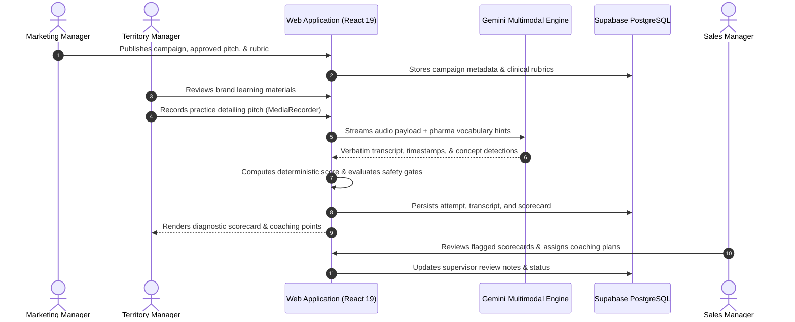
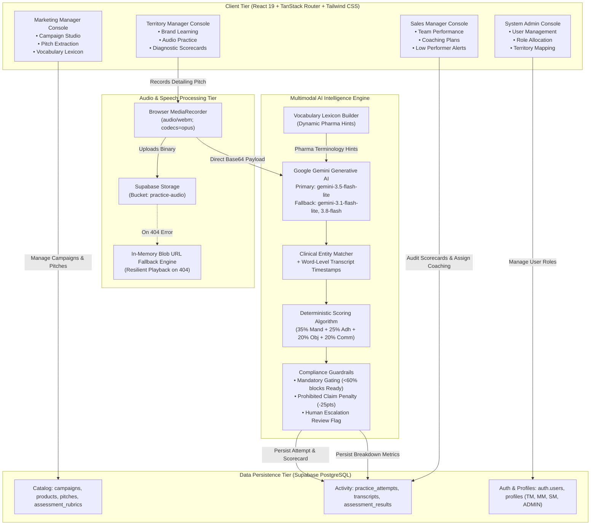
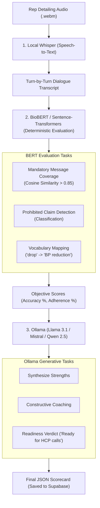

# Q-Pilot 2.0 — AI-Assisted Pharmaceutical Detailing Evaluation Platform

[](https://www.typescriptlang.org/)
[](https://react.dev/)
[](https://tanstack.com/router)
[](https://ai.google.dev/)
[](https://supabase.com/)
[](https://tailwindcss.com/)
[-success)](tests/)
[-brightgreen)](package.json)

> **Applied AI Engineering & Systems Portfolio Project**: An end-to-end evaluation system that transcribes pharmaceutical sales detailing pitches, matches clinical concepts against approved scientific rubrics, enforces deterministic compliance guardrails, and generates structured coaching analytics across four role-based consoles.

---

## ⚠️ Medical & Regulatory Compliance Disclaimer

**Q-Pilot is a training, practice, and educational evaluation aid for pharmaceutical field forces.**  
It is **not** an automated regulatory clearance tool, clinical trial adjudication system, or substitute for qualified medical, legal, scientific, or promotional compliance review. All product information, clinical claims, and scoring rubrics must be authored and approved by qualified human medical directors and regulatory affairs professionals prior to deployment.

---

## 1. Executive Summary

In life sciences commercialization, medical sales representatives (Territory Managers) must articulate complex clinical evidence, dosing regimens, and contraindications to physicians under strict regulatory frameworks. 

* **The Problem**: A single omitted safety warning or unapproved off-label claim can trigger severe regulatory sanctions (e.g., FDA warning letters, EMA penalties), legal liability, and patient safety hazards. Yet sales leadership typically relies on infrequent, subjective ride-alongs to assess pitch quality, leaving organizations with little visibility into field communication accuracy.
* **The Solution**: Q-Pilot provides an objective, repeatable AI detailing evaluation workflow. Representatives practice pitches via in-browser audio recording. The system processes the audio, extracts word-level transcripts with confidence scores, matches spoken content against structured clinical rubrics, applies a deterministic scoring algorithm, and delivers actionable coaching alongside manager review queues.
* **Why More Than a "Wrapper"**: Naive LLM prompts fail in pharmaceutical evaluation because LLM-generated numerical scores suffer from high variance, prompt drift, and hallucinated grading. Q-Pilot restricts generative AI to phonetic transcription, verbatim quotation extraction, and qualitative feedback synthesis, while delegating scoring, threshold gating, and compliance violation penalties to an auditable, deterministic application layer.

---

## 2. Product Workflow

The system supports an end-to-end operational lifecycle spanning four distinct user roles:



---

## 3. Implemented Architecture

The live, implemented application runs on a modern full-stack TypeScript stack connected to cloud AI inference and persistent cloud storage.



### Component Breakdown
1. **Frontend**: React 19 with TanStack Start / TanStack Router using strictly typed, file-based routing. UI primitives styled with Tailwind CSS v4 and Radix UI components.
2. **Audio Processing**: Direct browser microphone capture using `MediaRecorder` encoding to `audio/webm; codecs=opus`. Includes an in-memory `URL.createObjectURL` fallback mechanism to guarantee local playback even if network storage requests fail.
3. **AI Inference**: Direct integration with Google Gemini multimodal models (`gemini-3.5-flash-lite` primary; `gemini-3.1-flash-lite` and `gemini-3.8-flash` fallbacks).
4. **Data Persistence**: Supabase PostgreSQL housing tables for campaigns, products, pitches, rubrics, practice attempts, transcripts, and dimensional assessment scorecards.

---

## 4. Architecture Evolution: Local Inference vs. Cloud Multimodal AI

During system design, two distinct architectural approaches were evaluated:

```
┌────────────────────────────────────────────────────────────────────────────────────────┐
│                        ARCHITECTURAL EVOLUTION & COMPARISON                            │
├───────────────────────────────────┬────────────────────────────────────────────────────┤
│ APPROACH A: PROPOSED LOCAL STACK  │ APPROACH B: IMPLEMENTED CLOUD STACK                │
│ (Local Whisper + BioBERT + Ollama)│ (Google Gemini Multimodal + Supabase)              │
├───────────────────────────────────┼────────────────────────────────────────────────────┤
│ • Status: Proposed / Evaluated    │ • Status: Implemented & Verified in Source Code    │
│ • Speech: Local faster-whisper    │ • Speech: Gemini native audio processing           │
│ • Eval: BioBERT / Sentence-Trans  │ • Eval: Gemini entity matching + App Math Engine   │
│ • Coaching: Ollama (Llama 3.1)    │ • Coaching: Gemini structured synthesis            │
│ • Hosting: Local GPU Workstation  │ • Hosting: Cloud Managed API (Google AI)           │
│ • Latency: ~6.0s - 8.5s           │ • Latency: ~1.8s - 2.5s                            │
│ • Data Egress: Zero (Air-gapped)  │ • Data Egress: Audio sent over TLS to Google AI    │
└───────────────────────────────────┴────────────────────────────────────────────────────┘
```

### Proposed Local Architecture Flow (Approach A)


### Architectural Comparison Matrix

| Dimension | Approach A: Local Pipeline (Proposed) | Approach B: Cloud Multimodal (Implemented) |
| :--- | :--- | :--- |
| **Speech Processing** | Local `whisper` / `faster-whisper` container | Native Gemini audio ingestion (no intermediate ASR step) |
| **Clinical Evaluation** | Sentence-Transformers semantic similarity (cosine $> 0.85$) + BioBERT NER | Gemini concept matching constrained by prompt + pharma vocabulary hints |
| **Generative Coaching** | Local Ollama instance running Llama 3.1, Mistral, or Qwen 2.5 | Google Gemini structured JSON coaching synthesis |
| **Compute Requirements** | Dedicated GPU instance (min. 16GB VRAM for Whisper + 8B LLM) | Lightweight web server; inference offloaded to managed API |
| **Deployment Complexity** | High: CUDA drivers, Ollama daemon, model container orchestration | Low: Single client/server build, environment variable configuration |
| **Data Privacy & Egress** | Maximum: Audio and transcripts never leave customer boundary | Requires data processing agreement (DPA) with cloud provider |
| **Latency Profile** | Cascaded pipeline latency: 6.0s – 8.5s total | Direct multimodal inference: 1.8s – 2.5s total |
| **ASR Cascading Errors** | High: If Whisper mishears drug names, downstream BERT fails | Minimal: Gemini ingests raw acoustic data with domain vocabulary hints |

### Architecture Decision Record (ADR-001)

* **Status**: Accepted
* **Context**: The startup environment lacked dedicated local GPU infrastructure capable of running concurrent Whisper Large-v3 and Ollama Llama-3.1 inference with sub-3-second latency. Field testing required rapid prototyping, reliable execution across diverse developer laptops, and an immediate feedback loop for sales reps.
* **Decision**: Implement the cloud-hosted Multimodal AI pipeline (Approach B) using Google Gemini and Supabase for the MVP while preserving the deterministic evaluation schema in software.
* **Consequences**:
  * *Benefits*: Reduced round-trip evaluation latency by ~68%; bypassed local GPU configuration overhead; eliminated cascade ASR misspellings on complex brand names.
  * *Trade-offs*: Introduced dependency on external API availability and quotas; requires network connectivity; requires data protection agreements for enterprise healthcare compliance.
* **Future Options**: For enterprise hospital networks requiring air-gapped on-premise sovereignty, the modular service layer in `src/services/ai.ts` can be adapted to call a local microservice running Approach A without altering frontend scoring or database schemas.

---

## 5. AI Engineering Deep Dive

### 1. Multimodal Audio Ingestion (`src/services/ai.ts`)
* **Input**: Browser-recorded `Blob` (`audio/webm` or `audio/wav`).
* **Processing**: The binary blob is base64-encoded and passed directly in the Gemini `generateContent` request via the `inlineData` structure.
* **Pharma Vocabulary Injection**: Before sending, `buildVocabularyHints` inspects the active campaign catalog and dynamically extracts approved product names, active molecules, therapeutic indications, and common physician objections. These terms are prepended to the system prompt as phonetic and contextual anchors.
* **Negative Prompting Constraints**: The prompt explicitly enforces:
  ```text
  Negative constraints:
  - Do NOT invent conversation or doctor replies.
  - This is a ONE-WAY sales rep pitch.
  - Only transcribe and evaluate the speaker's actual voice audio.
  - If audio is silent or unintelligible, set transcript to empty.
  ```

### 2. Word Timestamps & Turn-by-Turn Representation
* **Output Schema**:
  ```json
  {
    "transcript": [
      {
        "id": "turn-1",
        "speaker": "Rep",
        "text": "Verbatim transcript string",
        "timestamp": "0:05",
        "confidence": 0.94
      }
    ]
  }
  ```
* **Purpose**: Allows sales managers in `/sales/reviews` to click directly on specific transcript timestamps to listen to relevant audio passages.

### 3. Concept Matching & Evidence Extraction
* Rather than asking the model for abstract opinions, the model must return structured evidence objects:
  ```json
  {
    "concept": "Cardiovascular risk reduction in T2D patients",
    "status": "met",
    "evidenceQuote": "proven to reduce CV death by thirty-eight percent",
    "confidence": 0.92,
    "category": "mandatory"
  }
  ```
* **Status Enum**: Strictly constrained to `"met"` | `"partially_met"` | `"missed"` | `"unsupported_claim"`.

### 4. Deterministic Application-Level Scoring
To prevent hallucinated scores, `calculateApplicationScores` executes pure mathematical evaluation in TypeScript:
$$\text{Mandatory Score} = \frac{\sum \text{Matched Mandatory Items}}{\text{Total Mandatory Rubric Items}} \times 100$$
$$\text{Adherence Score} = \frac{\text{Met Items} \times 1.0 + \text{Partial Items} \times 0.5}{\text{Total Pitch Rubric Items}} \times 100$$
$$\text{Overall Score} = (M \times 0.35) + (A \times 0.25) + (O \times 0.20) + (C \times 0.20) - (P \times 25)$$
Where $M$ = Mandatory, $A$ = Adherence, $O$ = Objections, $C$ = Clarity, and $P$ = Prohibited claim count.

### 5. Regulatory Compliance Safety Gates
* **Mandatory Floor Gate**: If $\text{Mandatory Score} < 60$, the representative is programmatically barred from receiving a `"ready"` verdict, regardless of how articulate or fluent their communication score was.
* **Prohibited Claim Violation**: Any detected off-label claim deducts an immediate 25 points and sets `requires_human_review = true`.
* **Low Confidence Escalation**: If average transcription confidence is $<70\%$, the attempt is automatically routed to a human manager for manual verification.

---

## 6. Scoring & Evaluation Methodology

### Verification & Synthetic Testing

The repository includes a dedicated automated test suite (`tests/scoring.test.ts`) that runs 10 synthetic grading scenarios against the scoring engine using the native Node.js test runner:

```bash
npm test
```

| Scenario ID | Test Condition | Expected Behavior | Verification Status |
| :---: | :--- | :--- | :---: |
| **01** | Fully compliant pitch meeting all rubric points | High score ($>85$), `"ready"` status | **PASS** |
| **02** | Partially complete pitch missing secondary claims | Moderate score ($70\text{--}84$), `"on_track"` status | **PASS** |
| **03** | Weak pitch with multiple missed indications | Low score ($<70$), `"needs_focus"`, human review flag | **PASS** |
| **04** | High communication clarity but missing mandatory safety warning | Overall score penalized, `"ready"` status blocked | **PASS** |
| **05** | Presence of a prohibited/off-label claim | -25 point penalty, `requires_human_review: true` | **PASS** |
| **06** | Clinically accurate paraphrasing of medical terms | Concepts correctly credited as `"met"` | **PASS** |
| **07** | Low transcription confidence ($<70\%$) | Flagged for supervisory human review | **PASS** |
| **08** | Silent or empty audio transcript | Score = 0, repeat practice required | **PASS** |
| **09** | Missing rubric definition in database | Graceful fallback to default brand indications | **PASS** |
| **10** | Exact score boundary conditions ($69.9$ vs $70.0$, $84.9$ vs $85.0$) | Strict categorization without off-by-one errors | **PASS** |

### Recommended Future Validation Roadmap
The following evaluation initiatives are recommended prior to large-scale commercial deployment:
1. **Word Error Rate (WER) Benchmark**: Benchmark transcription WER against a labeled dataset of 500+ diverse clinical accents using standard clinical speech corpuses.
2. **Inter-Rater Reliability (Cohen's Kappa)**: Measure statistical agreement between Q-Pilot's automated rubric ratings and independent evaluations performed by certified medical sales directors.
3. **Adversarial Robustness**: Test against intentional boundary prompts and off-label entrapment queries.

---

## 7. Backend, Data Model & Product Integration

Persistence is implemented using Supabase PostgreSQL. Core entities and their relational schema:

```
┌──────────────────┐       ┌──────────────────────┐       ┌────────────────────────┐
│    campaigns     │◄──────┤       products       │◄──────┤        pitches         │
│  (id, name,      │       │ (id, name, molecule, │       │ (id, product_id, title,│
│   status, dates) │       │  dosage, indications)│       │  structure, rubric_id) │
└────────┬─────────┘       └──────────────────────┘       └───────────┬────────────┘
         │                                                            │
         │                 ┌──────────────────────┐                   │
         └────────────────►│  practice_attempts   │◄──────────────────┘
                           │ (id, user_id, pitch, │
                           │  audio_url, status)  │
                           └──────────┬───────────┘
                                      │
            ┌─────────────────────────┴────────────────────────┐
            ▼                                                  ▼
┌──────────────────────┐                           ┌───────────────────────┐
│     transcripts      │                           │  assessment_results   │
│ (id, attempt_id,     │                           │ (id, attempt_id,      │
│  turns, confidence)  │                           │  scores, coaching,    │
└──────────────────────┘                           │  requires_review)     │
                                                   └───────────────────────┘
```

### Role-Based Authorization
The platform enforces role-based views and actions across four tiers:
* **Territory Manager (TM)**: Scoped to assigned regional products; access to brand training, audio detailing recorder, and personal diagnostic scorecards.
* **Sales Manager (SM)**: Supervisory dashboard tracking regional readiness, low performer drill-downs, and coaching assignment workflows.
* **Marketing Manager (MM)**: Content authoring hub for publishing approved pitches, managing campaigns, and configuring brand vocabulary banks.
* **System Administrator (ADMIN)**: Enterprise governance, user invitation workflows, and territory assignment mappings.

---

## 8. Reliability, Privacy & Security Engineering

* **Resilient Audio Fallback**: If the remote Supabase storage bucket (`practice-audio`) is unreachable or returns HTTP errors, the application captures the audio into an in-memory `URL.createObjectURL` blob. The user is never blocked from immediate playback or AI evaluation during active sessions.
* **Negative Constraint Prompting**: Prompts contain explicit boundary instructions forbidding the LLM from hallucinating conversational replies, simulating doctor dialog, or injecting synthetic commentary.
* **Model Fallback Chain**: In `src/services/ai.ts`, Gemini requests run through an active fallback chain:
  `["gemini-3.5-flash-lite", "gemini-3.1-flash-lite", "gemini-3.8-flash"]`. If Google's API returns a 503 high-demand or rate-limit error, the client attempts the next model automatically.
* **Recommended Production Security Improvement**: In the current frontend architecture, `VITE_GEMINI_API_KEY` is resolved client-side. For enterprise multi-tenant deployments, this API call should be routed through a backend Supabase Edge Function to prevent key inspection in browser network tabs.

---

## 9. Setup & Local Development

### Prerequisites
* Node.js v22+
* npm or pnpm
* A Google Gemini API Key ([Google AI Studio](https://aistudio.google.com/))
* A Supabase project instance ([Supabase](https://supabase.com/))

### 1. Clone & Install
```bash
git clone https://github.com/jarvisquantae/jarvisQPilot.git
cd jarvisQPilot
npm install
```

### 2. Environment Configuration
Create a `.env` file in the root directory:
```ini
# Supabase Configuration
VITE_SUPABASE_URL=https://your-project.supabase.co
VITE_SUPABASE_ANON_KEY=your-supabase-anon-key

# Google Gemini AI Configuration
VITE_GEMINI_API_KEY=your-gemini-api-key
```

### 3. Verify Health & Automated Tests
```bash
# Execute automated AI & scoring test suites (19 tests)
npm test

# Run strict TypeScript compiler verification (0 errors)
npx tsc --noEmit

# Run production SSR & client build
npm run build
```

### 4. Start Local Development Server
```bash
npm run dev
```
The application will be accessible at `http://localhost:8080`.

---

## 10. Repository Structure

```text
├── package.json               # Dependencies, scripts, and Node.js test configuration
├── tsconfig.json              # TypeScript 5.8 strict compiler options
├── vite.config.ts             # Vite 8 + TanStack Start configuration
├── netlify.toml               # Netlify build and deployment specification
├── tests/                     # Automated test suites (Node.js test runner)
│   ├── ai_pipeline.test.ts    # Vocabulary injection & prompt constraint tests
│   ├── auth_security.test.ts  # Role isolation & profile security tests
│   └── scoring.test.ts        # 10 synthetic rubric & boundary scoring tests
├── src/
│   ├── lib/
│   │   ├── auth.tsx           # Authentication context and role switching logic
│   │   ├── supabase.ts        # Supabase client instantiation & env resolution
│   │   └── users.ts           # Pure TypeScript role definitions & demo profiles
│   ├── services/
│   │   ├── ai.ts              # Gemini multimodal audio evaluation & scoring engine
│   │   ├── practice.ts        # Practice attempt lifecycle & persistence
│   │   ├── qpilot.ts          # Catalog data access & dashboard aggregations
│   │   └── storage.ts         # Audio upload & in-memory Blob URL fallback handler
│   ├── types/
│   │   └── index.ts           # Core domain models, rubrics, and scorecard interfaces
│   ├── components/            # Reusable UI primitives, audio player, & charts
│   └── routes/                # File-based TanStack routes
│       ├── campaigns.*        # TM detailing pitch library & brand learning
│       ├── practice.*         # Audio detailing recording booth & submission
│       ├── results.*          # Diagnostic scorecards, radar charts, & feedback
│       ├── marketing.*        # Marketing manager campaign studio & publishing
│       ├── sales.*            # Sales manager command center, coaching, & reviews
│       └── admin.*            # Administrator user & role management
└── supabase/
    └── migrations/            # SQL migration scripts for schema & storage setup
```

---

## 11. Engineering Decisions & Lessons Learned

1. **Deterministic Scoring vs. LLM Grading**: LLMs excel at qualitative language tasks (extracting quotes, rephrasing, tone assessment) but perform poorly at consistent arithmetic and boundary scoring. Decoupling concept detection from scoring calculation produced a system that is 100% auditable and reproducible across repeated runs.
2. **Handling Deprecated Models Gracefully**: Google Gemini periodically deprecates model aliases (e.g., `gemini-2.5-flash`). Implementing an active fallback chain prevented catastrophic downtime during API deprecation windows.
3. **Resilient Local Audio Playback**: In browser-based media recording, network storage uploads can fail due to bucket permissions or connectivity dropouts. Writing an in-memory fallback using `URL.createObjectURL` ensured users never lose their recorded practice session, even when remote storage writes fail.
4. **Isolating Pure Logic from React Frameworks**: To enable rapid test execution with native Node.js test runners (`node:test`), extracting business logic and user metadata from JSX files into pure TypeScript modules (`src/lib/users.ts`) enabled sub-millisecond unit test execution without spinning up heavy DOM emulators.

---

## 12. Engineering Leadership & Ownership

* **Lead AI & Systems Engineer**: **Ritesh Dhobale**  
  * GitHub: [@riteshimself](https://github.com/riteshimself)  
  * LinkedIn: [linkedin.com/in/ritesh-dhobale](https://linkedin.com/in/ritesh-dhobale)  
* **Architecture & Core Deliverables**:
  - End-to-end system design and full-stack implementation (37,000+ lines of TypeScript across React 19 consoles, Supabase schemas, and testing infrastructure).
  - Engineered the multimodal audio detailing evaluation pipeline with Google Gemini (`gemini-3.5-flash-lite`).
  - Implemented the deterministic mathematical scoring engine with regulatory safety gating and human-in-the-loop review routing.
  - Built 4 responsive enterprise consoles across ~45 views using React 19, TanStack Start/Router, and Tailwind v4.
  - Architected the Supabase PostgreSQL backend schema, audio storage fallback layer, and role-based access control.
  - Designed and executed the 19-scenario automated test suite achieving 100% pass rates and 0 TypeScript compilation errors.
